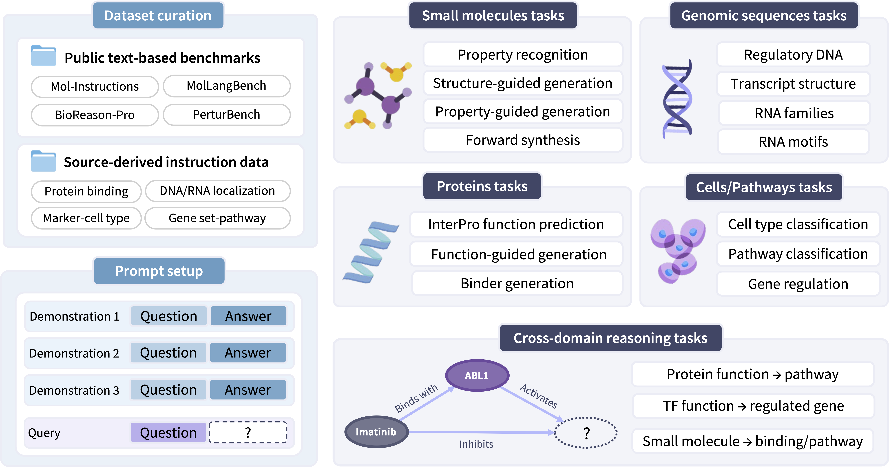

# TheBioCollection Evaluation

This repository contains the evaluation code for
[TheBioCollection-Eval](https://huggingface.co/datasets/trillionlabs/TheBioCollection-Eval). 
The benchmark covers small molecules, proteins, genomic sequences, cells/pathways, and
cross-domain knowledge-graph reasoning. 

<p align="center">
  
</p> 

Bring predictions from your own model, and this code will
score them against the public benchmark. The evaluator downloads the dataset from Hugging
Face by default and writes task-level summaries as JSON, CSV, and Markdown.

For the matched large-scale training corpus, see
[TheBioCollection](https://huggingface.co/datasets/trillionlabs/TheBioCollection).

## Prediction Format

Create a JSONL file with one prediction per evaluation record. The safest format is:

```jsonl
{"id":"cell_pathway/cell_eval_v3_replacement_100/hallmark_program_recognition/067","prediction":"G"}
{"id":"cross_domain_kg/protein_function_to_pathway/000","prediction":"A"}
```

Each row must contain:

- `id`: the record id from `TheBioCollection-Eval`
- one of `prediction`, `response`, or `output`: your model's answer

Id-less files are also accepted only when they contain exactly one row per gold record in
dataset order. For public results, prefer explicit ids.

## Run Evaluation

Install the evaluation dependencies:

```bash
python --version  # use Python 3.12
pip install -r requirements.txt
```

Protein design and binder-generation scoring requires local deep learning-based models for computing metrics in
addition to the Python packages above. Specifically, `protein_design` uses [ESM-C](https://github.com/Biohub/esm) sequence-embedding similarity as the functional-consistency metric plus
[ESMFold2-Fast](https://github.com/Biohub/esm) fold confidence. `binder_generation` uses ESMFold2-Fast complex
confidence metrics such as `ipTM` and complex pLDDT. Download the required model
checkpoints before running the full benchmark, then point the evaluator to local files
or local checkpoint directories:

```bash
export ESMC_MODEL=/path/to/esmc_600m_2024_12_v0.pth
export ESMFOLD2_MODEL=/path/to/ESMFold2-Fast
export PROTEIN_DEVICE=cuda
```

The default model identifiers are `biohub/esmc-600m-2024-12` and
`biohub/ESMFold2-Fast`, but evaluation is local-only: those identifiers are resolved
against the local Hugging Face cache and are not used as remote inference APIs. For
reproducible runs, pass local checkpoint paths with `--esmc-model` and
`--esmfold2-model`. If ESMFold2-Fast needs an isolated Python environment, set
`ESMFOLD2_PYTHON=/path/to/python`; otherwise the current Python interpreter is used.
The provided `requirements.txt` installs Biohub's Transformers fork because released
Transformers builds may not yet include the `esmfold2` architecture.

Evaluate a prediction file against the full benchmark:

```bash
PYTHONPATH=src python scripts/evaluate_thebiocollection.py \
  --predictions path/to/predictions.jsonl \
  --output-dir eval_outputs/my_model
```

The evaluator loads `trillionlabs/TheBioCollection-Eval` and the `test` split by default.
Outputs are written to:

```text
eval_outputs/my_model/summary.json
eval_outputs/my_model/summary.csv
eval_outputs/my_model/summary.md
```

Evaluate only one dataset config:

```bash
PYTHONPATH=src python scripts/evaluate_thebiocollection.py \
  --dataset-config protein__binder_generation \
  --predictions path/to/binder_predictions.jsonl \
  --output-dir eval_outputs/my_model_binder \
  --esmfold2-model /path/to/ESMFold2-Fast
```

Evaluate only selected tasks from the default config:

```bash
PYTHONPATH=src python scripts/evaluate_thebiocollection.py \
  --task hallmark_program_recognition \
  --task perturbench_replogle_k562 \
  --predictions path/to/predictions.jsonl \
  --output-dir eval_outputs/my_model_cells
```

Run a quick smoke test without model predictions:

```bash
PYTHONPATH=src python scripts/evaluate_thebiocollection.py \
  --dataset-config cell_pathway__hallmark_program_recognition \
  --use-ground-truth \
  --output-dir eval_outputs/smoke_test
```

## Local Test Files

If you already have a compatible local JSONL test file, pass it directly:

```bash
PYTHONPATH=src python scripts/evaluate_thebiocollection.py \
  --test-file path/to/test.jsonl \
  --predictions path/to/predictions.jsonl \
  --output-dir eval_outputs/local_run
```

The local file should use the same schema as the Hugging Face dataset: `id`, `domain`,
`task`, `task_group`, `instruction`, `input`, `target`, `target_format`, `metric`, and
`metadata`.

## License

This code is intended for research evaluation. Dataset use is governed by the
[TheBioCollection-Eval dataset card](https://huggingface.co/datasets/trillionlabs/TheBioCollection-Eval)
and the terms of the underlying source datasets. The benchmark is not intended for
clinical, diagnostic, or therapeutic decision-making.

## Cite

```bibtex
@article{TheBioCollection,
title={TheBioCollection: Unified Pre-Training Scale LLM Corpus for Biology},
author={Hyunjin Seo and Hyeon Hwang and Gyubok Lee and Jay Shin and Hongjoon Ahn and Sungjun Han and Sangwon Jung},
journal={arXiv preprint arXiv:XXX},
year={2026}
}
```
